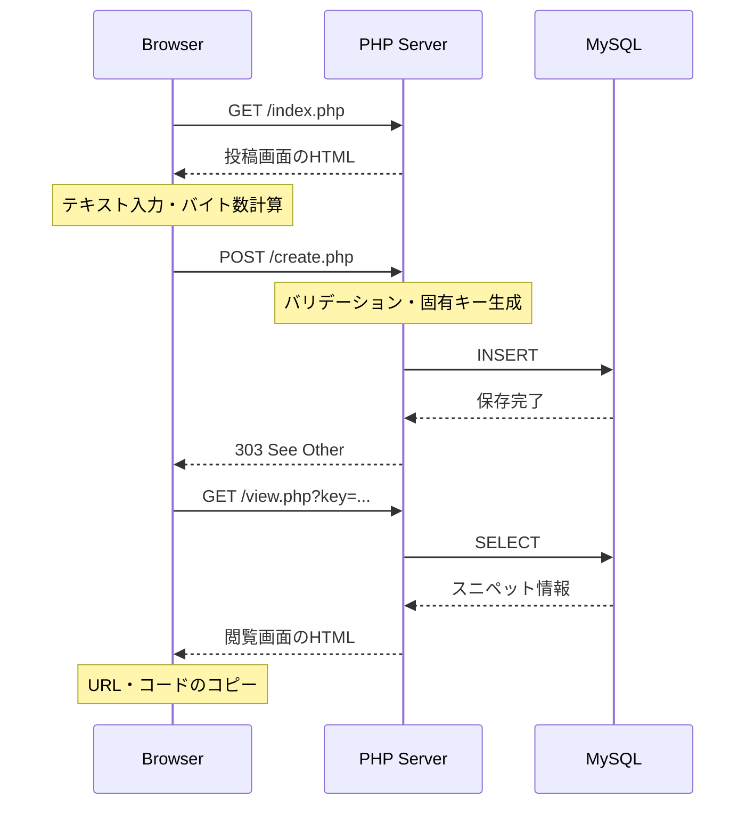

# Text Snippet Sharing Service

## 概要

テキストやソースコードを保存し、固有のURLを通じて共有できるWebアプリケーションです。

Pastebinのようなサービスを参考に、PHPとMySQLを使用して開発しました。

テキストの投稿・閲覧、有効期限の設定、共有URLの生成に加え、JavaScriptによるコピー機能やリアルタイムのバイト数表示を実装しています。

## 主な機能

### テキストの投稿・共有

- テキストやソースコードの投稿
- プログラミング言語の選択
- ランダムな固有キーの生成
- 固有URLによるスニペットの閲覧
- 有効期限の設定（無期限・1時間・24時間・7日間）
- 有効期限切れのスニペットの閲覧制限

### ユーザーインターフェース

- ダークテーマによる画面デザイン
- レスポンシブデザイン
- 共有URLのクリップボードへのコピー
- 投稿内容のクリップボードへのコピー
- リアルタイムのバイト数表示
- プログレスバーによる使用容量の可視化
- 容量超過時の警告表示と投稿ボタンの無効化

### バックエンド

- PDOを利用したデータベース操作
- MySQLWrapperによるデータベース接続処理の共通化
- マイグレーションによるテーブル管理
- 入力値のバリデーション
- HTTPステータスコードによるエラー処理
- PRG（Post/Redirect/Get）パターンによる二重投稿の防止

## 使用技術

| 技術 | 用途 |
| --- | --- |
| PHP 8.3 | バックエンド・HTML生成 |
| MySQL 8.0 | データベース |
| PDO | データベース接続・SQL実行 |
| HTML5 | 画面構築 |
| CSS3 | デザイン・レスポンシブ対応 |
| JavaScript | DOM操作・イベント処理 |
| Clipboard API | コピー機能 |
| TextEncoder | UTF-8のバイト数計算 |
| Composer | PHPの依存関係管理 |
| phpdotenv | 環境変数管理 |

## 開発環境

- Windows 10
- Ubuntu（WSL）
- Visual Studio Code
- DBeaver
- Git / GitHub

## ディレクトリ構成

```
TextSnippetSharingService/
├── public/
│   ├── index.php
│   ├── create.php
│   ├── view.php
│   ├── css/
│   │   └── style.css
│   └── js/
│       └── script.js
├── migrations/
│   └── 001_create_snippets.php
├── vendor/
├── MySQLWrapper.php
├── migrate.php
├── composer.json
├── composer.lock
├── .env
├── .env.example
├── .gitignore
└── README.md
```

### 各ファイルの役割

| ファイル | 役割 |
| --- | --- |
| index.php | スニペット投稿画面 |
| create.php | 入力検証・スニペットの保存 |
| view.php | スニペットの取得・閲覧画面 |
| style.css | 画面のデザイン |
| script.js | コピー機能・バイト数表示・容量制限 |
| MySQLWrapper.php | データベース接続・SQL実行 |
| migrate.php | マイグレーションの実行・履歴管理 |
| 001_create_snippets.php | snippetsテーブルの作成 |
| .env | データベース接続情報 |
| .env.example | 環境変数の設定例 |
| composer.json | 依存パッケージの定義 |
| composer.lock | 依存パッケージのバージョン管理 |

## セットアップ

### 1. 必要な環境

以下のソフトウェアがインストールされていることを確認してください。

- PHP 8.3
- PHP PDO MySQL拡張
- MySQL 8.0
- Composer

### 2. 依存パッケージのインストール

プロジェクトのルートディレクトリで実行します。

```bash
composer install
```

### 3. データベースの作成

MySQLに管理者権限で接続し、以下のSQLを実行します。

```sql
CREATE DATABASE practice_db
CHARACTER SET utf8mb4;

CREATE USER 'devuser'@'localhost'
IDENTIFIED BY 'your_password';

GRANT ALL PRIVILEGES
ON practice_db.*
TO 'devuser'@'localhost';
```

既存のデータベースやユーザーを使用する場合は、環境に合わせて設定してください。

### 4. 環境変数の設定

```bash
cp .env.example .env
```

.envファイルにデータベースの接続情報を設定します。

```env
DB_HOST=127.0.0.1
DB_PORT=3306
DB_NAME=practice_db
DB_USER=devuser
DB_PASSWORD="your_password"
```

実際のパスワードに変更してください。

.envファイルはGitの管理対象外としています。

### 5. マイグレーションの実行

```bash
php migrate.php
```

マイグレーションを実行すると、以下のテーブルが作成されます。

- migrations
- snippets

実行済みのマイグレーションは履歴テーブルに記録されるため、再実行時にはスキップされます。

### 6. サーバーの起動

```bash
sudo service mysql start
php -S localhost:8000 -t public
```

ブラウザで以下のURLにアクセスします。

http://localhost:8000/

## 使用方法

1. 投稿画面を開きます。
2. プログラミング言語を選択します。
3. テキストまたはソースコードを入力します。
4. バイト数と使用容量を確認します。
5. 有効期限を選択します。
6. Create Snippetボタンを押します。
7. 生成された固有URLの閲覧画面に移動します。
8. Copy URLボタンで共有URLをコピーできます。
9. Copy Codeボタンで投稿内容をコピーできます。

New Snippetリンクから新しい投稿画面に戻ることができます。

## アプリケーションの処理フロー

本アプリケーションでは、PHPによるSSR（Server-Side Rendering）を採用しています。



投稿時にはPRGパターンを使用しています。

POSTリクエストによる保存処理の完了後、303リダイレクトによってブラウザからGETリクエストを送信させます。

これにより、閲覧画面を再読み込みしても保存処理が再実行されることを防ぎます。

## エンドポイント

| HTTPメソッド | パス | 内容 |
| --- | --- | --- |
| GET | /index.php | 投稿画面の表示 |
| POST | /create.php | スニペットの保存 |
| GET | /view.php?key=... | スニペットの閲覧 |

### 投稿パラメータ

| パラメータ | 内容 |
| --- | --- |
| content | 投稿するテキスト |
| language | プログラミング言語 |
| expiration | 有効期限 |

### 対応言語

- Plain Text
- PHP
- JavaScript
- Python

言語の選択はスニペットの分類・表示に使用します。

### 有効期限

| 設定値 | 有効期限 |
| --- | --- |
| never | 無期限 |
| 1h | 1時間 |
| 24h | 24時間 |
| 7d | 7日間 |

有効期限はUTCで管理しています。

期限切れのスニペットは閲覧できませんが、データベースから自動的に削除されるわけではありません。

## データベース設計

### snippetsテーブル

| カラム | データ型 | 制約・用途 |
| --- | --- | --- |
| id | INT | PRIMARY KEY / AUTO_INCREMENT |
| unique_key | VARCHAR(64) | UNIQUE / NOT NULL |
| content | TEXT | NOT NULL |
| language | VARCHAR(50) | NOT NULL |
| created_at | DATETIME | DEFAULT CURRENT_TIMESTAMP |
| expires_at | DATETIME | NULL許可 |

固有キーは以下の処理によって生成しています。

```php
$key = bin2hex(random_bytes(16));
```

16バイトのランダムな値を32文字の16進数文字列に変換し、共有URLの識別子として使用します。

### migrationsテーブル

| カラム | データ型 | 制約・用途 |
| --- | --- | --- |
| id | INT | PRIMARY KEY / AUTO_INCREMENT |
| migration_name | VARCHAR(255) | UNIQUE / NOT NULL |
| executed_at | DATETIME | DEFAULT CURRENT_TIMESTAMP |

実行済みのマイグレーションを管理するためのテーブルです。

## バリデーション

投稿可能なテキストの最大容量は60,000バイトです。

### フロントエンド

- TextEncoderによるUTF-8のバイト数計算
- inputイベントによるリアルタイム更新
- プログレスバーによる使用容量の表示
- 容量超過時の文字色・バーの色の変更
- 容量超過時の投稿ボタンの無効化

### バックエンド

- HTTPメソッドの検証
- 空文字・空白のみの投稿の拒否
- strlen()によるバイト数の検証
- プログラミング言語の検証
- 有効期限の検証

フロントエンドのバリデーションはユーザーの利便性を向上させ、不要な通信を削減します。

バックエンドでも入力値を検証することで、フロントエンドを経由しない不正なリクエストにも対応します。

## セキュリティ対策

### SQLインジェクション対策

PDOのプリペアドステートメントを使用し、SQL文と入力値を分離しています。

### XSS対策

htmlspecialchars()を使用し、投稿されたテキストをHTMLとして解釈されないようにエスケープしています。

JavaScriptのコピー機能ではtextContentを使用して、表示されたテキストを取得しています。

### 接続情報の保護

データベースの接続情報は.envファイルに保存し、ソースコードから分離しています。

.envファイルは.gitignoreに登録しています。

### ドキュメントルートの分離

publicディレクトリをドキュメントルートとして設定しています。

これにより、環境変数ファイルやデータベース接続処理、マイグレーションファイルへの直接的なHTTPアクセスを防ぎます。

### エラー情報の管理

データベース接続やSQL実行時の例外はtry-catchで処理しています。

詳細なエラー情報はサーバーログに出力し、ブラウザには一般的なエラーメッセージを返します。

## HTTPステータスコード

| ステータスコード | 内容 |
| --- | --- |
| 200 OK | 正常な画面表示 |
| 303 See Other | 投稿成功後のリダイレクト |
| 400 Bad Request | 不正な入力値 |
| 404 Not Found | 存在しない、または期限切れのスニペット |
| 405 Method Not Allowed | 許可されていないHTTPメソッド |
| 500 Internal Server Error | データベース処理などのサーバーエラー |

## 動作確認

### ブラウザ

- 投稿・閲覧機能
- 言語・有効期限の選択
- Copy URL・Copy Code
- リアルタイムのバイト数表示
- プログレスバーの更新
- 容量超過時の投稿制限
- XSS対策
- 存在しないキーへのアクセス
- 有効期限切れの閲覧制限
- DevToolsによるJavaScriptエラーの確認

### curl

正常な投稿：

```bash
curl -i -d "content=Hello PHP&language=php&expiration=never" \
http://localhost:8000/create.php
```

空のテキストの投稿：

```bash
curl -i -d "content=&language=text" \
http://localhost:8000/create.php
```

許可されていないHTTPメソッド：

```bash
curl -i http://localhost:8000/create.php
```

存在しないキー：

```bash
curl -i "http://localhost:8000/view.php?key=notfound"
```

容量制限を超えた投稿：

```bash
curl -i \
--data-urlencode "content=$(python3 -c 'print("a" * 60001)')" \
-d "language=text" \
http://localhost:8000/create.php
```

環境変数ファイルへの直接アクセス：

```bash
curl -i http://localhost:8000/.env
```

### データベース

DBeaverを使用し、保存されたスニペットの内容、固有キー、作成日時、有効期限を確認しました。

また、マイグレーションの実行履歴と、不正な投稿が保存されないことを確認しました。

以上の手動テストにおいて、期待する動作を確認しました。

## 学習内容

本プロジェクトを通じて、以下の技術や設計について学習しました。

- PHPとMySQLによるWebアプリケーション開発
- PDOによるデータベース操作
- オブジェクト指向による処理の共通化
- マイグレーションによるデータベース管理
- Composerによる依存関係管理
- 環境変数による設定情報の管理
- HTTPリクエストとレスポンス
- SSRによるHTML生成
- PRGパターン
- SQLインジェクションとXSSへの対策
- フロントエンドとバックエンドの責務の分離
- JavaScriptによるDOM操作とイベント処理
- コールバック関数と非同期処理
- UTF-8の文字コードとバイト数
- CSSによる動的な画面表示

## 今後の改善案

- Monaco Editorによるコード編集機能
- シンタックスハイライト
- 期限切れスニペットの自動削除
- スニペットの編集・削除機能
- ユーザー認証
- レートリミット
- 自動テストの導入
- 本番環境へのデプロイ

## 注意事項

本アプリケーションは学習目的で開発したものです。

PHPの組み込みWebサーバーは開発環境での使用を想定しています。

localhostで生成された共有URLは、原則として同じコンピューター上でのみ利用できます。外部のユーザーと共有するには、アクセス可能なサーバーへのデプロイが必要です。

また、現在はユーザー認証を実装していないため、共有URLを知っているユーザーはスニペットを閲覧できます。機密情報の投稿には適していません。